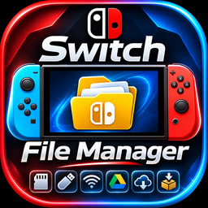

<p align="center">
  
</p>

<h1 align="center">Switch File Manager</h1>

<p align="center">
  <strong>Seus arquivos, lado a lado, no Nintendo Switch.</strong><br>
  Organize o microSD, trabalhe em lote, prepare transferências e conecte outros dispositivos por FTP ou Google Drive experimental.
</p>

<p align="center">
  <strong>0.10.11 experimental no PR #1</strong> · Release pública: <a href="https://github.com/TemudjinBR/switch-file-manager/releases/tag/v0.10.7">v0.10.7</a><br>
  Homebrew para Nintendo Switch desbloqueado com Atmosphère · C++17 e libnx
</p>

<p align="center">
  <a href="https://github.com/TemudjinBR/switch-file-manager/releases">Download público</a> ·
  <a href="#funcionalidades">Funcionalidades</a> ·
  <a href="#como-instalar">Instalação</a> ·
  <a href="docs/README.md">Documentação</a> ·
  <a href="https://github.com/TemudjinBR/switch-file-manager/pull/1">Desenvolvimento</a>
</p>

---

## O que é

O **Switch File Manager** é um gerenciador de arquivos para usar diretamente no Nintendo Switch desbloqueado, incluindo Switch Lite. A interface Commander mantém duas pastas abertas ao mesmo tempo: escolha a origem em um painel, o destino no outro e copie ou mova os itens sem alternar repetidamente de pasta.

Além das operações no microSD, reúne seleção em lote, busca, favoritos, histórico, fila local de transferências, FTP, integração experimental com Google Drive, compactação ZIP e informações de espaço ocupado. A navegação funciona com os botões do console e com a tela sensível ao toque.

**Estado atual:** o aplicativo e esta revisão continuam experimentais. “Implementado” significa que o recurso existe no código e pode ser acionado; a validação automática, a compilação e os testes físicos são evidências distintas. Consulte a [matriz de testes](docs/TESTES.md) e o [relatório da revisão](docs/RELATORIO_VALIDACAO.md).

> **Resultados fisicos da 0.10.10, relatados pelo proprietario:** acesso ao Drive, Manter conectado e desconectar/reconectar funcionaram. FTP, FTP apos Drive, identificacao da versao e recuperacao de download com queda de internet falharam. A Missao 3.1 nao esta aprovada para producao. A **0.10.11 experimental** acrescenta diagnosticos na tela, downloads recuperaveis e identidade do build; ainda exige nova validacao fisica. O relato historico **“Falha ao salvar login no cartão SD.”** permanece registrado em [Google Drive](docs/GOOGLE_DRIVE.md).

## Por que usar

| Diferencial | Benefício no uso diário |
| --- | --- |
| Duas pastas abertas | Origem e destino permanecem à vista durante as operações. |
| Operações em lote | Marque arquivos e pastas, inverta a seleção e trabalhe com vários itens. |
| Navegação organizada | Combine ordenação, filtro por nome, favoritos e diretórios recentes. |
| Fila local | Prepare até 20 tarefas de cópia ou movimentação antes de executá-las. |
| Transferência pela rede | Acesse o SD por FTP; explore também o Drive, ainda experimental. |
| ZIP no próprio console | Compacte seleções e extraia no painel atual ou no painel oposto. |
| Visão do armazenamento | Veja espaço livre, propriedades e os maiores itens da pasta. |
| Proteções e diagnósticos | Confirmações, verificações nos fluxos suportados e logs ajudam a identificar falhas. |

## Funcionalidades

O catálogo abaixo cobre os menus, submenus e módulos da revisão 0.10.11. Todas as categorias estão **implementadas**; Google Drive permanece **experimental**, com a falha conhecida acima. A [referência de funcionalidades](docs/FUNCIONALIDADES.md) relaciona cada categoria ao código e detalha limites de sessão, persistência e validação.

### 1. Interface e navegação

- **Dois painéis independentes:** abra pastas diferentes no SD ou use um painel local e outro do Drive. O painel ativo recebe as ações e o outro fornece o destino nas transferências compatíveis.
- **Controles físicos e toque:** alterne o painel, abra itens, suba diretórios, navegue por páginas e role as listas. As pastas aparecem antes dos arquivos.
- **Informações na listagem:** nome, tipo visual, tamanho de arquivos, caminho e ordem atual. A data local aparece quando a ordenação por data está selecionada; documentos nativos do Drive recebem indicação própria.
- **Atualização das listagens:** comando manual em **Ações → Ordenar e buscar → Atualizar as listas**, após operações e ao detectar alterações concluídas pelo FTP. Atualizar a lista limpa as marcações.

### 2. Arquivos e pastas

- **Copiar arquivos e pastas**, inclusive conjuntos de itens, do painel ativo para o painel oposto.
- **Mover arquivos e pastas locais:** usa renomeação quando possível; no caminho alternativo, copia, compara integralmente e só então tenta remover a origem.
- **Renomear**, **criar pastas** e **excluir arquivos ou pastas**, com confirmação antes de apagar. No Drive, a exclusão usa a lixeira.
- **Progresso de transferência:** item atual, bytes, percentual e, quando disponíveis, contagem de arquivos, velocidade média e estimativa de tempo restante.
- **Solicitação de cancelamento por B** nos fluxos que consultam o progresso. Isso não garante interromper uma exclusão recursiva em andamento. A conferência byte a byte pertence ao fallback de mover local: não é uma verificação automática de toda cópia nem uma garantia transacional.

### 3. Seleção múltipla avançada

O menu **Ações → Seleção múltipla** oferece individualmente:

- Marcar todos os itens visíveis.
- Marcar somente arquivos.
- Marcar somente pastas.
- Inverter a marcação visível.
- Limpar todas as marcações.

“Visíveis” são os itens da listagem filtrada, inclusive os que exigem rolagem. Marcar arquivos ou pastas acrescenta marcações às existentes; limpe antes se quiser um conjunto exclusivo. Use a seleção nas operações compatíveis de cópia, movimentação, exclusão, ZIP e propriedades. Sem marcações, as ações usam o item em foco.

### 4. Organização e localização

- **Ordenar por nome, tamanho, data ou tipo** e **inverter a ordem**; as pastas continuam agrupadas antes dos arquivos. Tamanho começa pelos maiores, data pelos mais recentes.
- **Buscar por nome**, filtrar a pasta atual, limpar a busca e atualizar os dois painéis. Não é busca recursiva no cartão; a comparação usa o tratamento de caixa existente no código, sem promessa de normalização de todos os acentos.
- **Favoritos locais:** adicionar a pasta atual, abrir uma favorita e removê-la da lista.
- **Histórico local:** reabrir diretórios recentes e limpar o histórico com confirmação. Guarda até 15 caminhos, sem a raiz do SD.

Favoritos e histórico são salvos no cartão. Ordenação, inversão, filtro e marcações pertencem à sessão; não são preferências persistidas. Entrar ou subir uma pasta limpa o filtro. [Detalhes de armazenamento](docs/ARMAZENAMENTO.md).

### 5. Fila de transferências locais

Em **Ações → Fila de transferências**, é possível **adicionar cópias**, **adicionar movimentações**, **ver tarefas pendentes**, **executar a fila** e **limpar as tarefas** sem apagar arquivos.

A fila aceita **até 20 tarefas**, cada uma podendo conter vários itens, somente entre pastas do SD. Adicionar uma tarefa ainda não transfere os arquivos. A execução acompanha o progresso e, em falha ou cancelamento, mantém a tarefa interrompida e as seguintes para revisão. **A fila não persiste após encerrar o aplicativo e não aceita Google Drive.** Uma tarefa parcialmente executada não é desfeita automaticamente.

### 6. Google Drive — experimental

- Configurar **credenciais OAuth individuais** e entrar pelo servidor local acessado no celular.
- **Navegar por pastas**, listar arquivos e carregar páginas sucessivas da API.
- **Baixar arquivos e árvores de pastas para o SD** e **enviar arquivos e pastas do SD**.
- **Criar pastas**, **renomear itens**, **enviar para a lixeira**, renovar a autorização e desconectar/trocar de conta mediante confirmação.
- **Gerenciar a conta**: Entrar com Google, Manter conectado, Reconectar conta salva, Desconectar conta, Trocar de conta e Esquecer esta conta. O nome é mostrado quando a API o disponibiliza.
- Retornar um painel do Drive ao SD sem necessariamente desconectar a conta.

A correção de persistência da Missão 3 foi preservada e ampliada na 0.10.11: o login só é confirmado após gravar e reler o token. Erros locais aparecem como **SD**, separados das respostas **Google** e de **Rede**; uma autorização recebida pode ser salva novamente pelo botão **Tentar salvar login novamente**, sem repetir a troca de código. O acesso e a persistencia funcionaram no teste fisico relatado da 0.10.10; os novos downloads e diagnosticos ainda exigem teste no Lite. **Mover SD ↔ Drive está bloqueado**, copiar diretamente Drive → Drive não é suportado, documentos nativos Google não são exportados e ZIP remoto não está disponível. PKCE S256 e state protegem a autorização atual, ainda experimental; a API usa HTTPS nativo no console; o formulário local de configuração usa HTTP na porta 8080 e deve ser aberto somente em rede confiável.

**Downloads recuperaveis:** checkpoint local com CRC, versao remota conferida, Range/If-Range, espera progressiva limitada, pausa/continuacao/cancelamento por X/B ou toque e recuperacao em **Acoes → Downloads do Drive** apos reiniciar. O destino final so aparece completo. Parciais ficam em area tecnica separada; cancelar preserva o parcial e exige escolha explicita para continuar. [Contrato e limites](docs/DOWNLOADS_DRIVE.md).

[Configuração, capacidades, caminhos e limitações do Google Drive](docs/GOOGLE_DRIVE.md).

### 7. FTP e transferência Wi-Fi

- **Servidor FTP integrado na porta 2121**, iniciado e encerrado em **Ações → Transferência Wi-Fi**. O aplicativo mostra o endereço exato para conectar pelo cliente FTP.
- **Upload e download de arquivos**, listagem de diretórios, navegação, criação e remoção de pastas vazias, exclusão de arquivos, renomeação e consulta de tamanho/data.
- **Modos passivo e ativo**, listagens LIST/NLST/MLSD/MLST e **retomada de download com REST**. A retomada de upload é recusada.
- **Estado do servidor:** clientes conectados, arquivos concluídos, total transferido e última atividade. O cabeçalho também informa clientes, listagens e arquivos; o limite de código é de quatro clientes.

O ciclo de sockets é compartilhado com o Drive, sem segunda inicialização nem encerramento indevido. Falhas registram `Result` para diagnóstico; a correção candidata do relato no Lite exige validação física.

**O acesso é anônimo, sem senha e sem TLS, ao SD inteiro.** Use somente rede local confiável; não exponha o servidor em rede pública. A implementação usa temporários e verificações, mas não há comprovação de estabilidade prolongada com arquivos muito grandes no Switch. [Uso, protocolo e limites do FTP](docs/FTP.md).

### 8. Compactação e extração ZIP

- **Compactar arquivos, pastas ou vários itens** no SD, pelo modo **rápido** ou **sem compressão** disponível no menu.
- **Extrair na pasta atual ou no painel oposto**, dentro de uma pasta de destino com nome disponível.
- **Inspecionar o ZIP:** quantidade de arquivos e pastas, tamanho descompactado e indicação de conteúdo protegido por senha.
- **Conferir CRC ao extrair**, acompanhar progresso, solicitar cancelamento e rejeitar caminhos absolutos ou com tentativa de sair do destino.

Itens criptografados, com caminhos inseguros ou formatos não suportados são ignorados e contabilizados; não há extração com senha. **ZIP64 e arquivos maiores que 4 GiB precisam de validação específica; FAT32 limita o tamanho de cada arquivo.** A interface não oferece o nível “normal” da biblioteca como uma terceira opção de compactação. [Guia ZIP](docs/ZIP.md).

### 9. Armazenamento e propriedades

- **Capacidade total, espaço livre e indicador de utilização do SD** no cabeçalho, quando a consulta ao sistema estiver disponível.
- **Propriedades de arquivos e pastas:** tipo, tamanho, local, data quando disponível e contagem de conteúdo local.
- **Propriedades de seleção múltipla:** quantidade de itens, tamanho acumulado e conteúdo calculado.
- **Análise de espaço ocupado:** lista até os **nove maiores itens imediatos** da pasta, com tamanho e percentual do total calculado; escolher um deles o focaliza na listagem.

Os cálculos locais podem ser incompletos diante de itens inacessíveis e têm limite de profundidade no cálculo de propriedades. Pastas do Drive não têm tamanho total calculado nesse diálogo, e datas remotas não são obtidas pela listagem atual. Não há indicador de bateria ou relógio implementado na interface. [Limites dos cálculos](docs/ARMAZENAMENTO.md).

### 10. Abrir aplicativos homebrew

Reconhece arquivos **`.nro` locais** e pede confirmação antes de encerrar o gerenciador e solicitar a abertura pelo Homebrew Menu. Depende de o modo de execução oferecer `envSetNextLoad`; o aplicativo informa quando esse mecanismo não está disponível. Os demais arquivos mostram informações básicas; não há visualizador geral de conteúdo.

**Instalação de jogos `.NSP`, `.XCI` e `.NSZ` não está implementada.** Os símbolos presentes no logotipo oficial não representam uma lista de recursos disponíveis.

### 11. Proteções das operações

- Confirmações de exclusão e aviso adicional para pastas importantes do sistema/CFW.
- Nomes disponíveis gerados para evitar colisões nos fluxos compatíveis; cópias e downloads protegidos usam criação exclusiva do destino.
- Rejeição de cópia de pasta para dentro dela mesma e de destinos conflitantes nos fluxos verificados.
- Preservação da origem quando a cópia do fallback de movimentação falha; comparação byte a byte antes de iniciar a remoção.
- Tentativa de limpar a saída parcial criada pela operação, tratamento de cancelamentos e mensagens de erro.
- Validação de nomes FAT/exFAT e proteção de componentes de caminhos ZIP.

São medidas de prevenção, **não garantias absolutas contra perda de dados**. Alterações simultâneas, falhas do cartão, energia e exclusão parcial continuam exigindo atenção. Avisos na interface não bloqueiam globalmente o acesso FTP. [Problemas conhecidos](docs/PROBLEMAS_CONHECIDOS.md).

### 12. Diagnósticos e manutenção

- **Logs persistentes** de início/fim, ações e eventos/erros instrumentados, com timestamp e proteção entre threads.
- **Rotação em torno de 1 MiB**, mantendo um arquivo anterior; linhas têm tamanho limitado.
- Retorno de erro de gravação e informação em stderr quando a falha do logger muda. Ainda não existe uma tela própria para falhas do logger, nem rastreamento completo de toda operação.

Logs novos: `sdmc:/switch/Switch File Manager/logs/sfm.log` e `sfm.log.1`. O diretório antigo de logs é preservado. Credenciais, token, favoritos e histórico continuam em **`sdmc:/switch/switch-manager/`**. Essa compatibilidade de dados não altera o projeto separado Switch-Manager. Revise nomes, caminhos e IPs nos logs antes de compartilhá-los.

## Telas

Não foram encontradas capturas autênticas do Switch File Manager no repositório ou nos anexos disponíveis nesta missão. O logotipo acima é a marca oficial, não uma captura da interface.

A galeria está preparada para receber imagens reais conforme o [guia de capturas](docs/screenshots/README.md). Nenhum mockup, imagem gerada ou tela de outro aplicativo foi apresentado como prova de funcionamento.

## Como instalar

1. **Escolha a origem:** [Releases](https://github.com/TemudjinBR/switch-file-manager/releases) reúne versões públicas; a última verificada nesta missão é a **v0.10.7**. O [PR #1](https://github.com/TemudjinBR/switch-file-manager/pull/1) contém a **0.10.11 experimental** e os [artefatos de Actions](https://github.com/TemudjinBR/switch-file-manager/actions) são para testes.
2. **Baixe `SwitchFileManager.nro`** e o checksum correspondente. A Release v0.10.7 oferece o NRO avulso; não pressupõe o ZIP de distribuição criado no desenvolvimento atual.
3. **Confira o SHA-256** com uma ferramenta de confiança e coloque o NRO em `sdmc:/switch/Switch File Manager/` no microSD. Se estiver usando o ZIP de teste, extraia sua pasta `switch` na raiz do cartão.
4. **Abra pelo Homebrew Menu** em um console desbloqueado com Atmosphère. Preserve as configurações já existentes em `switch/switch-manager`.
5. **Confira a versão do arquivo baixado** pela tag da Release, execução de Actions e metadados NACP apresentados pelo launcher quando disponíveis. O log de início também registra a versão. **O cabecalho mostra versao e build. Acoes → Versao e diagnostico do NRO mostra o caminho em execucao e permite conferir copias no SD, sem exclui-las.**

Para comparar hashes no terminal: `sha256sum SwitchFileManager.nro`. A verificação ajuda a conferir o download, mas não substitui os testes no console.

### Conferir o executável instalado

O pacote experimental identifica **switch/Switch File Manager/SwitchFileManager.nro**, sua versão NACP e SHA-256 em `LEIA-ME.txt`/manifesto. O menu **Ações** mostra a versão que está realmente em execução; o log `APP` registra o caminho do NRO. Uma cópia antiga em outro diretório pode continuar aparecendo no Homebrew Menu. Nenhuma cópia ou dado pessoal é apagado automaticamente. A [investigação da versão](docs/VERSAO_E_INSTALACAO.md) distingue metadados comprovados de hipóteses no console.

## Controles

| Contexto e controle | Ação |
| --- | --- |
| Listas: ↑/↓ ou analógico esquerdo vertical | Mover o foco; manter pressionado repete a navegação. |
| Listas: ← / → | Ativar o painel esquerdo / direito. |
| Listas: L ou R | Alternar o painel ativo. |
| Listas: ZL / ZR | Subir / descer uma página de itens. |
| Listas: A / B | Abrir item / subir uma pasta; A em ZIP ou NRO abre as opções correspondentes. |
| Listas: Y | Marcar ou desmarcar o item e avançar o foco quando houver próximo item. |
| Listas: X | Abrir o menu Ações e seus submenus. |
| Listas: − / + | Alternar SD/Drive no painel ativo / sair. |
| Menus: ↑/↓, ZL/ZR, A/B | Navegar, saltar páginas, confirmar / cancelar. |
| Progresso: B | Solicitar cancelamento onde suportado; não é uma parada instantânea universal. |
| Login Drive: B ou botão Cancelar por toque | Sair do diálogo de login. |
| Toque nas listas | Selecionar; tocar no mesmo item já focado do painel ativo o abre. |
| Arrastar nas listas ou menus | Rolar quando houver conteúdo além da área visível. |
| Toque nos botões inferiores e nas opções de menu | Acionar a função indicada; toque fora do modal cancela esse menu. |

As tabelas descrevem os contextos do código: **+ não é um comando global garantido dentro de qualquer modal**. A entrada de nomes usa o teclado de sistema do Switch. O mapa completo está em [Controles](docs/CONTROLES.md).

## Integrações e dados

| Área | Guia |
| --- | --- |
| Gerenciamento local, favoritos e histórico | [Armazenamento e persistência](docs/ARMAZENAMENTO.md) |
| Google Drive e OAuth — experimental | [Configuração, falha conhecida e restrições](docs/GOOGLE_DRIVE.md) |
| FTP pela rede local | [Conexão, operações e segurança](docs/FTP.md) |
| ZIP no microSD | [Compactação, extração e limites](docs/ZIP.md) |

O uso do FTP local não exige serviço pago. Drive requer conta e projeto OAuth próprios e segue as cotas e condições do Google; não há promessa de armazenamento ilimitado ou gratuidade de qualquer plano externo.

## Desenvolvimento

| Caminho | Responsabilidade |
| --- | --- |
| `src/` | Aplicação, núcleo, UI, armazenamento, rede, nuvem, ZIP, diagnósticos e segurança. |
| `include/` | Contratos dos módulos. |
| `assets/` | Ícone oficial; regras de preservação em `assets/branding/`. |
| `scripts/` | Preparação, versão, build, validação NRO e distribuição. |
| `tests/` | Suíte automatizada com executáveis C++ de host e serviços locais de teste. |
| `docs/` | Guias, referência, auditoria, validação e materiais históricos identificados. |
| `third_party/` | Bibliotecas incorporadas com seus créditos e licenças. |
| `.github/workflows/` | CI e publicação manual com critérios separados. |

A arquitetura modular e a apresentação anteriores foram preservadas. `VERSION` está em **0.10.11** e é a fonte para NACP, pacote e log inicial. A Missao 3.2 acrescenta diagnosticos FTP/NRO e gerencia downloads recuperaveis; o logotipo e as demais funcionalidades permanecem preservados.

```bash
python3 tests/run.py
bash scripts/build.sh
```

O script compila com devkitPro disponível ou com o ambiente em nuvem já preparado, valida o NRO e cria `dist/`. [Comandos completos, requisitos e critérios de validação](docs/TESTES.md).

## Limitações e próximos passos

A causa exata das falhas fisicas de FTP e versao continua em aberto. Acesso Drive, Manter conectado e desconectar/reconectar funcionaram no relato do proprietario da 0.10.10; isso nao aprova a Missao 3.1 para producao. A nova candidata requer a [matriz fisica](docs/VALIDACAO_SWITCH_LITE_3_2.md), incluindo perda de rede, pausa/retomada e identidade do NRO. Os testes automatizados estao no [relatorio](docs/RELATORIO_VALIDACAO.md).

**Planejado, não disponível:** USB OTG e armazenamento externo, atualização automática, instalação de pacotes de jogos, novos provedores de nuvem e exportação de documentos Google. Não há prazo prometido. Consulte o [roadmap](docs/ROADMAP.md) e os [problemas conhecidos](docs/PROBLEMAS_CONHECIDOS.md).

## Acompanhe o projeto

- [Notas e histórico de alterações](CHANGELOG.md).
- [Pull Request de desenvolvimento](https://github.com/TemudjinBR/switch-file-manager/pull/1) e [checks de Actions](https://github.com/TemudjinBR/switch-file-manager/actions).
- [Documentação por assunto](docs/README.md) e [referência para retomar o trabalho](docs/REFERENCIA.md).
- [Relatar um problema](https://github.com/TemudjinBR/switch-file-manager/issues), com passos e dados de ambiente, sem credenciais ou códigos OAuth.

A documentação reformulada aparece primeiro na branch do PR; a página da `main` só muda depois de uma integração aprovada. Esta missão não faz merge nem publica Release.

## Créditos e licenciamento

Projeto de **[TemudjinBR](https://github.com/TemudjinBR)**. A identidade visual oficial foi fornecida pelo proprietário e preservada em `assets/icon.jpg`.

- **devkitPro, devkitA64 e libnx:** ferramentas e serviços de plataforma do homebrew Switch.
- **miniz:** operações ZIP, com a declaração de domínio público/Unlicense preservada nos fontes.
- **stb_truetype:** rasterização da fonte do sistema, com os avisos MIT/domínio público preservados.
- **[Omni36OS](https://github.com/mpjsilva/omni36os):** referência de organização, apresentação e documentação para continuidade; nenhum código ou identidade desse projeto foi incorporado.

O repositório ainda **não define uma licença geral do aplicativo**. Esta missão não escolhe uma licença pelo proprietário. Consulte os [créditos dos terceiros](third_party/README.md).
