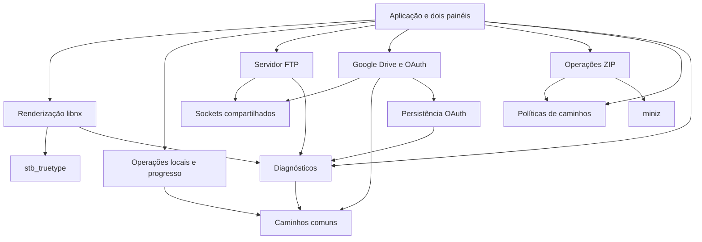

# Arquitetura

## Plataforma e fluxo

O executável usa C++17 sem RTTI/exceções, libnx, devkitA64 e renderização por software em 1280×720. Não houve troca de toolkit, linguagem ou interface. A fonte vem do serviço de fontes do sistema; stb_truetype rasteriza e mantém um cache de glifos, liberado no encerramento.

O loop principal processa botões/toque, atualiza os dois painéis, acompanha alterações do FTP e desenha a interface. Modais e transferências continuam coordenados pela aplicação. O armazenamento recebe um contrato de progresso, sem conhecer libnx ou os painéis.

## Fronteiras atuais

- `core`: sem serviços do Switch; constantes de caminhos e manipulação básica de caminhos SD.
- `storage`: POSIX, leitura de diretórios, cópia com destino exclusivo, comparação byte a byte e remoção. Retorna erros ao chamador. O chamador valida origem/destino e pede confirmação na UI.
- `security`: saneamento FAT/exFAT, aviso para pastas críticas, rejeição de traversal ZIP e geração de nonces/desafio PKCE. Produção usa CSRNG/SHA-256 libnx; testes usam getrandom e hash portátil conferido com referência independente.
- `ui`: recursos gráficos, desenho e texto; falhas de fonte/framebuffer/memória são registradas. A aplicação recebe o estado da inicialização.
- `network`: socket_runtime coordena uma posse por FTP/Drive e o último encerra libnx; falhas registram Result/contexto e permitem retry. O FTP mantém até quatro clientes, porta 2121, sockets de controle/dados e contadores atômicos. A atualização dos painéis usa `fileChanges()`.
- `cloud`: mantém HTTP/TLS, JSON e OAuth em `gdrive.cpp`; `credential_store.cpp` separa persistência e recuperação. Produção usa SSL nativo; `HOST_TEST` redireciona a API para loopback, sem TLS.
- `archives`: miniz, inspeção, compressão, extração, CRC, cancelamento e tratamento de erro ao finalizar saída.
- `diagnostics`: mutex único de gravação, timestamp, linhas limitadas a 4096 bytes, retorno booleano e `lastErrorCode()`. Rotaciona antes de abrir quando o arquivo atinge 1 MiB; uma linha pode ultrapassar levemente o limiar. Mantém um backup. Falha de log não derruba o aplicativo; o erro aparece também em stderr quando muda.
- `app`: modelo `Pane`, estados, menus, diálogos e integração de progresso. A extração de controladores é progressiva, não houve reescrita.

## Proteções de dados

A cópia local recusa um destino existente usando criação exclusiva. A limpeza de falhas fica no módulo que criou a saída; a aplicação só limpa uma cópia concluída que reprovou na verificação. Mover no mesmo volume usa rename; no fallback copia e compara antes de remover a origem. A comparação não é uma transação e não bloqueia alterações concorrentes da origem.

Downloads Drive conferem tamanho recebido e `Content-Range`. HTTP 416 e conteúdo insuficiente são falhas; não há preenchimento artificial para simular o tamanho esperado. Credenciais/tokens são gravados com escrita parcial tratada, fsync/close e releitura. O anterior vai a backup reservado e o candidato ao caminho legado, sempre com destino livre; falhas tentam restaurar o anterior. O login só é confirmado após outra releitura. Não há garantia de atomicidade contra falha elétrica nem lock contra outros processos. Ver [persistência OAuth](GOOGLE_DRIVE_PERSISTENCIA.md).

Uploads FTP usam `.sfm-part`, criação exclusiva, sincronização e substituição com `.sfm-backup`. Temporários preexistentes são preservados. O serviço mantém acesso anônimo explicitamente avisado na UI; não oferece criptografia.

O caminho de configuração legado é independente do novo caminho de logs. Não há cópia automática, exclusão ou migração dos dados pessoais.

## Compilação e distribuição

O Makefile descobre os fontes nas pastas explicitadas em `SOURCES` e recusa nomes de arquivos duplicados entre módulos. Headers ficam em `include`, terceiros em seus diretórios e cabeçalho de versão em `build/generated`. Nomes de `.cpp/.c` precisam ser únicos porque os objetos usam basename.

`VERSION` alimenta `APP_VERSION` e `SFM_VERSION`; a alteração também invalida o NACP incremental. `prepare.py` só escreve quando o conteúdo gerado muda. Os scripts em `scripts/legacy` são entradas de compatibilidade que chamam a preparação atual.

`validate_nro.py` verifica segmentos executáveis, ASET, intervalos de assets, ícone JPEG, NACP, título e versão. Isso não executa o binário. `package.py` inclui somente NRO, instruções, manifesto e checksums, com ordem e timestamps ZIP fixos. A repetição com o mesmo NRO produz o mesmo ZIP; não há garantia de NRO idêntico entre toolchains diferentes ou diretórios com debug paths distintos.

## Camada de apresentação e documentação

A Missão 2 preserva todos os módulos C++, headers, versão e imagem incorporada. README/índice/guias descrevem as capacidades efetivas e seus menus, sem gerar uma nova UI do aplicativo.

A validação de documentação usa `scripts/check_docs.py` (biblioteca padrão) para links Markdown/HTML, âncoras e referências a imagens. A renderização visual de revisão usa navegador e CSS de Markdown compatível com GitHub em arquivos temporários do ambiente; não entra no NRO e não depende de serviço pago. As prévias não são capturas do Switch.

Na Missão 3, a reprodução passou a impor a semântica de rename sem sobrescrita do libnx. A incompatibilidade do código anterior foi demonstrada; o sucesso no SD físico continua pendente. Consultar [GOOGLE_DRIVE.md](GOOGLE_DRIVE.md).

## Gerenciamento de contas na 0.10.10

A UI continua Commander com os mesmos modais/controles/toque. O menu de conta se comunica com gdrive sem expor tokens. Transferências remotas são síncronas, então uma troca só começa entre operações; durante autorização novas chamadas remotas são recusadas.

O registro drive-account.json reúne autorização e preferência para um commit único. A importação dos arquivos legados preserva originais; a precedência do novo estado impede retorno indevido à conta antiga. Cancelamento conserva uma sessão anterior em memória e sucesso limpa os painéis remotos. Esquecimento primeiro persiste bloqueio sem token e depois remove só cópias atribuíveis, com impressões para retomar exclusão parcial. Não existe revogação remota ou lista de contas simultâneas.

A geração NACP usa comparação de conteúdo para evitar metadados obsoletos com timestamps preservados, e a distribuição identifica caminho/versão/hash. Inspeção de duplicados é somente leitura. Ver [versão e instalação](VERSAO_E_INSTALACAO.md).

## Transferencias recuperaveis e identidade — 3.2

DownloadManager separa controle/persistencia de HTTP/OAuth. O adaptador Drive valida metadados e Content-Range antes de gravar; a maquina consulta novamente a versao antes de acrescentar/publicar. Checkpoints locais registram offset/CRC e revisao conhecida, com dados em parcial exclusivo. O journal reutiliza a gravacao verificada de persist::File::Transfer; nenhuma credencial vai no journal.

A UI continua sincrona, com callbacks de progresso/controle e pausa que suspende requisicoes apos fechar a operacao corrente. Parada de rede tem backoff limitado, e recuperacao apos reinicio e explicita pelo menu. Arvores preservam arquivos concluidos e a estrutura criada quando um arquivo falha.

Na 0.10.12, SSL nao bloqueante e waitIo sao usados nas chamadas interativas Drive: repetem WouldBlock, respeitam limites/controle e propagam erros de certificado. A logica OAuth/persistencia aprovada permanece; o transporte TLS interativo agora tambem consulta o callback UI e requer revalidacao fisica. DNS e E/S SD ainda dependem do sistema; TCP interativo usa polling curto/timeout.

BuildInfo e somente leitura. A identidade de fontes entra no cabecalho gerado e no NRO/manifesto, com validação pelo empacotador; nao depende de .git presente na copia devkitPro.

## Concorrência delimitada — 0.10.12

FTP mantém listener e até quatro threads clientes; Drive e desenho permanecem na thread principal. O callback de rede faz polling de controles e redesenho limitado a 80 ms, sem chamadas Drive recursivas. Nenhuma thread FTP acessa painéis/desenho/OAuth. O callback pode iniciar/parar FTP enquanto a chamada HTTP/TLS aguarda. A parada Drive marca cancelamento e adia closeNetwork até o último RequestScope sair, depois do destrutor Conn fechar seus descritores/contexto de conexão.

A posse do runtime continua protegida por mutex e idempotente por serviço. O orçamento é oito sessões BSD, fallback para três somente em erros explícitos de recursos. Esperas FTP/TCP usam sockets não bloqueantes e select instantâneo; a espera de 10 ms ocorre fora da sessão IPC. O worker é dono do fechamento de seu socket; não há shutdown concorrente na UI sobre descritores reutilizáveis. SSL usa WouldBlock/timeout já verificados sem ignorar certificado.

Isso não transforma Drive numa API multithread: estados JSON/OAuth/diagnóstico permanecem restritos à thread chamadora. Não chamar netInit/netExit/API Drive de outro worker. A UI pode solicitar cancelamento, mas DNS síncrono, latência de disco e serviços do console ainda podem atrasar sua resposta. Não se implementou navegação livre nos dois painéis durante uma transferência remota.

## Atualizador — Missão 3.3

`src/updates/update_core.cpp` concentra parser/manifesto, SHA-256 incremental e transação; `update_service.cpp` coordena preferências/worker; `network/update_http.cpp` oferece HTTPS separado do OAuth. Cada chamada mantém posse Updates no runtime e contexto SSL próprio; não chama gdrive nem desenha. A UI lê snapshots protegidos por mutex. `tools/updater/updater_main.cpp` é outro NRO, com o mesmo build, que instala após o principal sair. Makefile gera os dois executáveis em diretórios separados e inclui o auxiliar na identidade dos fontes. [Transação e confiança](ATUALIZACOES.md).

## Interface na 0.10.14

A política [navigation.h](../include/ui/navigation.h) separa menu global/contextual/saída e fornece o rodapé físico/tátil; libnx injeta seus bits reais no roteador. `Session` mantém pedido de menu, confirmação de saída e cancelamento cooperativo, sem manipular a seleção. Fluxos síncronos deferem o menu até retorno seguro; saída aguarda workers/FTP e libera sockets pelo ciclo normal.

[about_view.cpp](../src/ui/about_view.cpp) usa blit RGB888 do renderer: 196.608 bytes de arte em readonly e cache RGB do QR original de 11.163 bytes. Sem paleta, decodificação JPEG por quadro ou nova biblioteca runtime. HOST_TEST troca somente fonte/framebuffer para testar o desenho real; a fonte Nintendo e o timing precisam do Lite.
