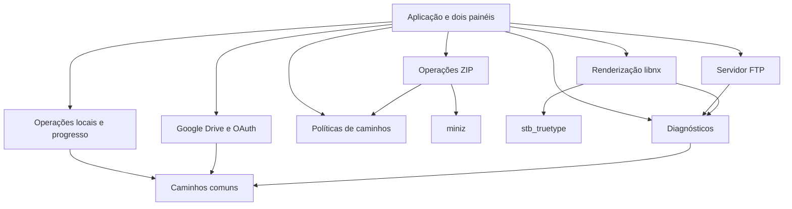

# Arquitetura

## Plataforma e fluxo

O executável usa C++17 sem RTTI/exceções, libnx, devkitA64 e renderização por software em 1280×720. Não houve troca de toolkit, linguagem ou interface. A fonte vem do serviço de fontes do sistema; stb_truetype rasteriza e mantém um cache de glifos, liberado no encerramento.

O loop principal processa botões/toque, atualiza os dois painéis, acompanha alterações do FTP e desenha a interface. Modais e transferências continuam coordenados pela aplicação. O armazenamento recebe um contrato de progresso, sem conhecer libnx ou os painéis.

## Fronteiras atuais

- `core`: sem serviços do Switch; constantes de caminhos e manipulação básica de caminhos SD.
- `storage`: POSIX, leitura de diretórios, cópia com destino exclusivo, comparação byte a byte e remoção. Retorna erros ao chamador. O chamador valida origem/destino e pede confirmação na UI.
- `security`: saneamento FAT/exFAT, aviso para pastas críticas e rejeição de caminhos ZIP absolutos ou com `..`.
- `ui`: recursos gráficos, desenho e texto; falhas de fonte/framebuffer/memória são registradas. A aplicação recebe o estado da inicialização.
- `network`: até quatro clientes FTP, porta 2121, sockets de controle/dados e contadores atômicos. A atualização dos painéis usa `fileChanges()`.
- `cloud`: mantém HTTP/TLS, JSON e OAuth no mesmo módulo nesta etapa para preservar o fluxo existente. Produção usa SSL nativo; `HOST_TEST` redireciona a API para loopback, sem TLS.
- `archives`: miniz, inspeção, compressão, extração, CRC, cancelamento e tratamento de erro ao finalizar saída.
- `diagnostics`: mutex único de gravação, timestamp, linhas limitadas a 4096 bytes, retorno booleano e `lastErrorCode()`. Rotaciona antes de abrir quando o arquivo atinge 1 MiB; uma linha pode ultrapassar levemente o limiar. Mantém um backup. Falha de log não derruba o aplicativo; o erro aparece também em stderr quando muda.
- `app`: modelo `Pane`, estados, menus, diálogos e integração de progresso. A extração de controladores é progressiva, não houve reescrita.

## Proteções de dados

A cópia local recusa um destino existente usando criação exclusiva. A limpeza de falhas fica no módulo que criou a saída; a aplicação só limpa uma cópia concluída que reprovou na verificação. Mover no mesmo volume usa rename; no fallback copia e compara antes de remover a origem. A comparação não é uma transação e não bloqueia alterações concorrentes da origem.

Downloads Drive conferem tamanho recebido e `Content-Range`. HTTP 416 e conteúdo insuficiente são falhas; não há preenchimento artificial para simular o tamanho esperado. Credenciais/tokens são gravados em temporário e substituídos após write/flush/fsync/close bem-sucedidos; não se trata de garantia contra qualquer falha elétrica do cartão.

Uploads FTP usam `.sfm-part`, criação exclusiva, sincronização e substituição com `.sfm-backup`. Temporários preexistentes são preservados. O serviço mantém acesso anônimo explicitamente avisado na UI; não oferece criptografia.

O caminho de configuração legado é independente do novo caminho de logs. Não há cópia automática, exclusão ou migração dos dados pessoais.

## Compilação e distribuição

O Makefile descobre os fontes nas pastas explicitadas em `SOURCES` e recusa nomes de arquivos duplicados entre módulos. Headers ficam em `include`, terceiros em seus diretórios e cabeçalho de versão em `build/generated`. Nomes de `.cpp/.c` precisam ser únicos porque os objetos usam basename.

`VERSION` alimenta `APP_VERSION` e `SFM_VERSION`; a alteração também invalida o NACP incremental. `prepare.py` só escreve quando o conteúdo gerado muda. Os scripts em `scripts/legacy` são entradas de compatibilidade que chamam a preparação atual.

`validate_nro.py` verifica segmentos executáveis, ASET, intervalos de assets, ícone JPEG, NACP, título e versão. Isso não executa o binário. `package.py` inclui somente NRO, instruções, manifesto e checksums, com ordem e timestamps ZIP fixos. A repetição com o mesmo NRO produz o mesmo ZIP; não há garantia de NRO idêntico entre toolchains diferentes ou diretórios com debug paths distintos.
