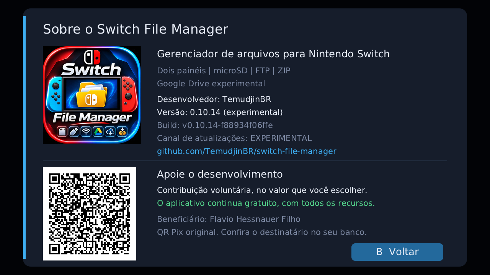
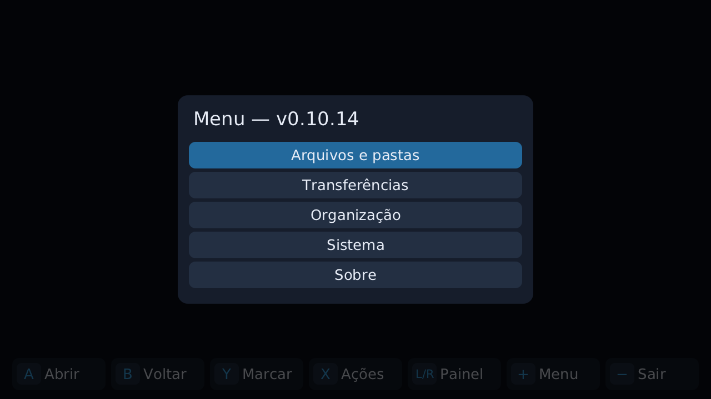
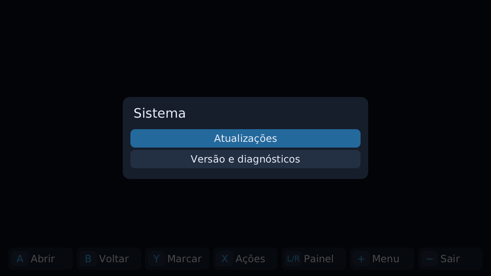
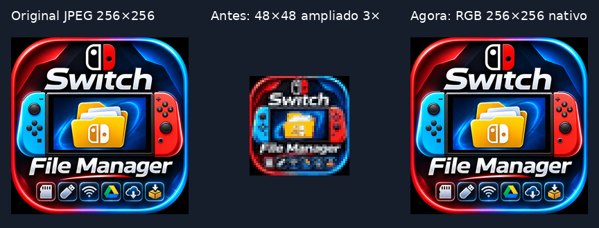

# Missão 3.6 — menu global, atalhos, Sobre e ícone

Candidata **0.10.14 experimental**, [PR #3](https://github.com/TemudjinBR/switch-file-manager/pull/3), na branch `codex/menu-global-sobre-0-10-14`, baseada no PR #2 (`02d6b065bb20a888452d7f380fb96f84f2abb402`), preservando o PR #1 (`84e3f769e69380bfae74f7a23a0e3c67f7a9188e`). **PENDENTE DE TESTE FÍSICO no Switch Lite**. Sem merge, alteração da main ou publicação de Release.

## Causas verificadas e mudança

O código da base ligava + a g_quit e − a toggleDrive, enquanto X misturava menu global e contextual. O Sistema tinha Sobre e duas entradas para a mesma tela de atualizações. A arte oficial 256×256 era reduzida a uma miniatura paletizada 48×48, desenhada com ampliação: perda de detalhe comprovada no processo de derivação, sem atribuir outras causas ao hardware.

Agora + abre cinco categorias independentes da seleção; X só opera no alvo e orienta quando ausente; − confirma e solicita cancelamento cooperativo, usando o encerramento normal dos serviços. A recusa preserva a sessão. Durante uma operação síncrona, + aguarda retorno seguro. Não se adiciona navegação concorrente a um motor síncrono. Sistema fica com duas ações reais; SD/Drive tem rota explícita em Arquivos e pastas. [Inventário antes/depois e checklist](MENU_CONTEXTUAL.md).

Sobre passa a ser a quinta entrada da raiz. Mostra nome, descrição, autor, versão incorporada, build, **canal de atualizações** e repositório; depois, apoio opcional. O padrão ESTÁVEL de busca de atualizações não torna esta candidata homologada.

A arte é RGB888 nativa 256×256 (196.608 bytes readonly), sem paleta, filtro, ampliação ou JPEG decodificado a cada quadro. Um blit direto substitui preenchimentos por pixel. O QR usa a matriz aprovada, cache RGB de 11.163 bytes e escala inteira com quiet zone. Não há biblioteca runtime nova.

Diagnóstico de NRO selecionado calcula SHA-256 somente por leitura. A ferramenta de manutenção inclui nomes ocultos/extensão maiúscula. Não remove nada, não pressupõe qual caminho o Homebrew Menu abriu, nem recomenda limpeza de dados.

## Evidências de validação

A base foi conferida antes de editar: PRs #1/#2 abertos e não mesclados, SHAs acima, CI do PR #2 verde na execução 42303714671; suíte de **196 testes**, compilação real principal/auxiliar e pacote 0.10.13 passaram no ambiente configurado. Essa execução antiga não valida a nova candidata.

A candidata amplia a suíte para **207 testes** (11 novos), preservando os 196 existentes com expectativas atualizadas para os atalhos substituídos. A etapa host passou, com três casos reservados ao NRO; a execução final com `--nro` passou nos **207 testes, sem falhas ou skips**, conferindo também o binário real. Os resultados conclusivos constam na tabela abaixo e no Actions do novo PR, associado ao seu SHA exato. Nenhum teste usa dados do proprietário.

| Verificação | Resultado |
| --- | --- |
| Host: política/contexto/toque/saída/cópia e regressões anteriores | 207 casos; host passou com 3 skips de NRO; etapa com NRO passou nos 207, sem skips |
| Principal devkitPro/libnx | Compilado, 1.242.840 bytes, título Switch File Manager, NACP 0.10.14 |
| Auxiliar devkitPro/libnx | Compilado, 386.776 bytes, título Atualizador do Switch File Manager, NACP 0.10.14 |
| Build incorporado nos dois NROs | v0.10.14-f88934f06ffe, correspondente aos fontes |
| Ícone NACP | Igual byte a byte ao JPEG oficial |
| Distribuição | ZIP validado: dois NROs nos caminhos oficiais, manifesto, LEIA-ME e SHA256SUMS, sem credenciais/configurações |
| Documentação | 36 arquivos ativos com links/âncoras/imagens conferidos; Markdownlint e actionlint aprovados |
| Arte | Derivação determinística conferida e comparação visual host realizada; QR original decodificado sem pagamento |
| Switch Lite, applet/memória completa e SD real | **PENDENTE DE TESTE FÍSICO** |

Compilação real via `/workspace/sfm-environment/build.sh`, chamada por `bash scripts/build.sh`, em contêiner devkitPro fixado por digest; devkitA64 r29.2-1 e libnx 4.12.0-1. Nenhuma funcionalidade é declarada homologada por isso.

A política real de entrada e o modelo contextual são executados no host. Confirmação/recusa de saída passa também pelo motor real de cópia com fixtures. A suíte mantém regressões anteriores de FTP/OAuth/recuperação/atualizador. Asserções textuais de integração não são apresentadas como execução integral da UI libnx ou encerramento real dos serviços no console.

Falhas intermediárias foram corrigidas antes da entrega: três âncoras antigas ficaram inválidas após atualizar o guia; os links/título foram ajustados. Um binário de uma primeira cópia de compilação foi recusado corretamente por divergência de build depois de um ajuste de fonte durante aquela compilação; foi descartado e a compilação foi repetida com fontes congelados. A validação final não aceita esse binário anterior. Avisos de funções não usadas do stb são mantidos como avisos de terceiro, sem erro de compilação.

### Checksums da compilação em nuvem local

Estes hashes identificam **a compilação no ambiente desta missão**. O Actions imprime seus próprios sidecars e publica os arquivos daquele SHA; caminhos de compilação podem alterar bytes, portanto conferir os hashes do mesmo artefato que for instalado.

| Arquivo | SHA-256 |
| --- | --- |
| SwitchFileManager.nro | 2f7e7a7cadafc391b9c422f2c702a40d617e9efe1cde5cbd5bf2f1909f0417f8 |
| SfmUpdateHelper.nro | 8f2db94304afd5d71a7619d1964594ea60ffa8f69f8420f291bd48a11713a62c |
| SwitchFileManager-v0.10.14.zip | a7d28789ef8f10f38e0d41a4f6b83873287431a997f4257e41dcca34bd610821 |

A execução Actions do SHA de entrega e o download **SwitchFileManager-validado** são conferidos e vinculados no PR de entrega; não confundir com a execução antiga do PR #2. Sem merge ou Release nesta missão.

## Prévias visuais do host

Estas imagens usam o desenho real do aplicativo, mas framebuffer em memória e **DejaVu Sans substituindo a fonte Nintendo**. Build `v0.10.14-f88934f06ffe`; Pillow 13.0.0 apenas para conversão do JPEG/PNG no ambiente de QA. O fundo das prévias de menu não contém os painéis reais. Não são capturas do Switch nem homologação física.

## Fidelidade da arte e QR

- JPEG oficial/NACP preservado: SHA-256 `858ebcb92444859e77ba2485a9532bedda25254ddc00d3fca72517eb5ff38cca`.
- RGB888 decodificado, sem redimensionamento: SHA-256 `3e5c0287dc0e75eef26e2f19f94b4fd8a89030eea277ad6556afe9cbb46fcf62`.
- SVG Pix original: SHA-256 `b706a3a0c94d27d231648a5539a60abaf710d46638a5dec201fd28c58b08fbc5`.
- Matriz C++ Pix preservada: SHA-256 `f268795998e29a126464a569f44cec8ae25d3c5c2a443856be9bbb37350cdb89`.
- QR da prévia real do renderer decodificado por zxing-cpp: Pix, beneficiário original Flavio Hessnauer Filho, sem campo de valor fixo e CRC16 válido. SHA-256 do payload: `a288c18e397fc6d5f5d042293392f090032f06335b9f106d9871106583ada354`. Nenhum pagamento realizado; não é comprovação de leitura na tela física.

O backend HOST_TEST usa o mesmo código de desenho/blit/texto com fonte DejaVu Sans e framebuffer em memória. As prévias são **host, com fonte substituta**, não capturas de Switch. Conferir no aparelho fonte Nintendo, iluminação, pixels da tela, toque, memória e latência.

## Limitações e preservação

Motores FTP 2121, OAuth/credenciais, downloads, ZIP, arquivos pessoais, dois painéis, projeto separado Switch-Manager, capa e doação do README permanecem preservados. A fila local ainda é volátil; o aviso de saída informa isso. Operações já concluídas não são desfeitas e DNS/SD podem atrasar cancelamento. Instalação do auxiliar não ganha uma interrupção insegura. Sem alegar correção física de FTP/Drive, fila unificada ou retomada de upload.

[Instalação Android inequívoca](VERSAO_E_INSTALACAO.md) · [Controles](CONTROLES.md) · [Testes](TESTES.md).

## Arquivos e reprodução

Mudanças principais: `src/app/main.cpp`, `include/ui/navigation.h`, `include/ui/context_actions.h`, `src/ui/menu_view.cpp`, `src/ui/about_view.cpp`, renderer e contratos correspondentes; `include/ui/official_icon.h` e gerador; testes de navegação/contexto/distribuição/documentação; `VERSION`, preparo do pacote, inspeção somente leitura e log de checksums do CI. O workflow instala a fonte só para testes no contêiner e usa o SHA do head do novo PR, evitando confundir o commit sintético de merge com o candidato. A configuração de Markdown aceita a tag small já existente no apoio do README, sem alterar essa seção.

Documentos: README, CHANGELOG, índice, CONTROLES, MENU_CONTEXTUAL, FUNCIONALIDADES, VERSAO_E_INSTALACAO, ARQUITETURA, REFERENCIA, TESTES, PROBLEMAS_CONHECIDOS, rotas FTP/Drive/ZIP/Atualizações e notas v0.10.14; quatro imagens de prévia claramente identificadas. A lista exata é o diff do novo PR, exclusivamente em relação ao PR #2.

Comandos: `bash scripts/build.sh`, `python3 scripts/check_docs.py`, `python3 scripts/generate_about_icon.py --check`, `git diff --check`, `actionlint` e `markdownlint-cli2`. As verificações de NRO também extraem NACP/ícone/build do principal e do auxiliar, comparam o ZIP e checam distribuição sem dados privados. O CI publica os hashes dos arquivos exatos enviados aos artefatos.
